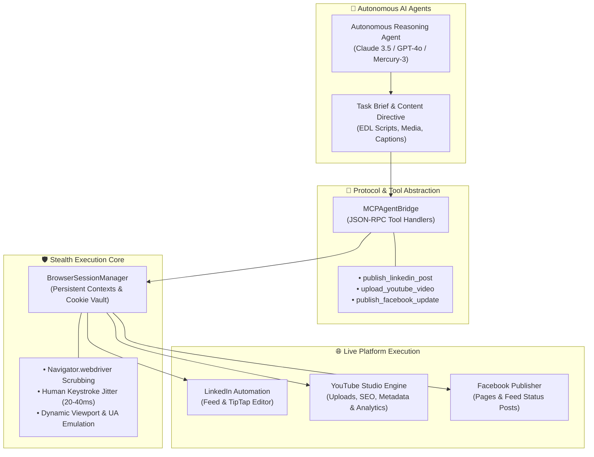

# 🤖 Autonomous Browser Agent Hub

<div align="center">


<p align="center">
  <b>Production Multi-Platform Autonomous Browser Agent Engine</b><br/>
  <i>Self-driving browser automation across LinkedIn, YouTube Studio, and Facebook powered by Playwright Stealth and Model Context Protocol (MCP).</i>
</p>

</div>

---

## ⚡ Architecture & Orchestration

The **Autonomous Browser Agent Hub** enables autonomous AI agents (Claude Opus, GPT-4o, InceptionLabs Mercury-3, Gemini 2.0) to operate real-world social platforms through resilient, human-like browser actions without API lock-in or rate-limit penalties.



---

## 🚀 Key Modules & Capabilities

### 1. 💼 LinkedIn Autonomous Publisher (`src/platforms/linkedin_publisher.ts`)
- **Rich Text Handling**: Bypasses complex TipTap/DraftJS virtual DOM wrappers by emitting native keyboard events.
- **Media Attachment**: Automates file drop and file dialog inputs for carousels, infographics, and banners.
- **Stealth Timing**: Human typing cadence with randomized pauses (1.5s–3.5s) to avoid bot flags.
- **Visual Evidence**: Automatically captures viewport screenshots after submission to verify feed placement.

### 2. 🎥 YouTube Studio Autonomous Manager (`src/platforms/youtube_studio_manager.ts`)
- **End-to-End Upload Pipeline**: Uploads MP4/WebM binaries directly through `studio.youtube.com`.
- **Metadata Injection**: Automated population of video titles, descriptions, chapters, and SEO tags.
- **Compliance Toggling**: Automatically completes "Made for Kids" radio selectors and visibility stages (Public / Unlisted / Private).
- **Studio Analytics Scraping**: Extracts channel views, watch time, and subscriber growth without OAuth scopes.

### 3. 📱 Facebook Publisher (`src/platforms/facebook_publisher.ts`)
- **Cross-Surface Posting**: Supports publishing directly to user profiles or managed business Pages.
- **Rich Media Support**: Single or multi-image attachments with preview verification.
- **Session Preservation**: Uses persistent browser profiles (`userDataDir`) to survive 2FA and multi-day session lifespans.

### 4. 🔌 Model Context Protocol (MCP) Bridge (`src/core/mcp_agent_bridge.ts`)
- Implements the open standard Model Context Protocol.
- Enables agent frameworks (Antigravity, LangChain, AutoGen, CrewAI) to discover tools and call browser actions programmatically via JSON schemas.

---

## 📦 Directory Structure

```
autonomous_browser_agent_hub/
├── src/
│   ├── core/
│   │   ├── browser_session_manager.ts   # Persistent context & stealth flags
│   │   └── mcp_agent_bridge.ts          # MCP tool schema definitions & router
│   ├── platforms/
│   │   ├── linkedin_publisher.ts        # LinkedIn feed & TipTap automation
│   │   ├── youtube_studio_manager.ts    # YouTube Studio video upload & metrics
│   │   └── facebook_publisher.ts        # Facebook feed & Page status updates
│   └── index.ts                         # System export & CLI runner
├── package.json
├── tsconfig.json
├── .gitignore
└── README.md
```

---

## 🛠️ Quickstart & Usage

### 1. Installation

```bash
git clone https://github.com/shabbir2024a-dot/autonomous-browser-agent-hub.git
cd autonomous-browser-agent-hub
npm install
npm run build
```

### 2. Programmatic TypeScript API

```typescript
import { MCPAgentBridge } from 'autonomous-browser-agent-hub';

// Initialize agent bridge with persistent session profile
const agent = new MCPAgentBridge('./user_data_profile', false);

// Execute an autonomous LinkedIn publication
const result = await agent.executeTool('publish_linkedin_post', {
  content: '🚀 Scaling autonomous AI agent infrastructure with Playwright and MCP! #AI #Automation',
  mediaPath: '/absolute/path/to/banner.png'
});

console.log('Publication Result:', result);
```

### 3. CLI Testing

```bash
# Inspect available MCP agent tools
npm start

# Run dedicated platform tests
npm run agent:linkedin
npm run agent:youtube
npm run agent:facebook
```

---

## 🛡️ Security & Privacy Architecture

- **Zero Hardcoded Credentials**: This engine never accepts or stores plain-text passwords. All authentication relies on encrypted local persistent session contexts (`userDataDir`) or pre-authenticated browser cookies.
- **Git Guardian Protected**: `.gitignore` strictly blocks all session caches (`userDataDir/`), screenshots (`screenshots/`), and local environment files (`.env*`).
- **Rate-Limiting & Jitter**: Built-in pacing ensures requests conform to human operational velocity, protecting accounts from platform security trips.

---

## 📜 License

Distributed under the **MIT License**. Engineered for production autonomous AI workflows by [Shabbir Ahmed (Bishal)](https://github.com/shabbir2024a-dot).
