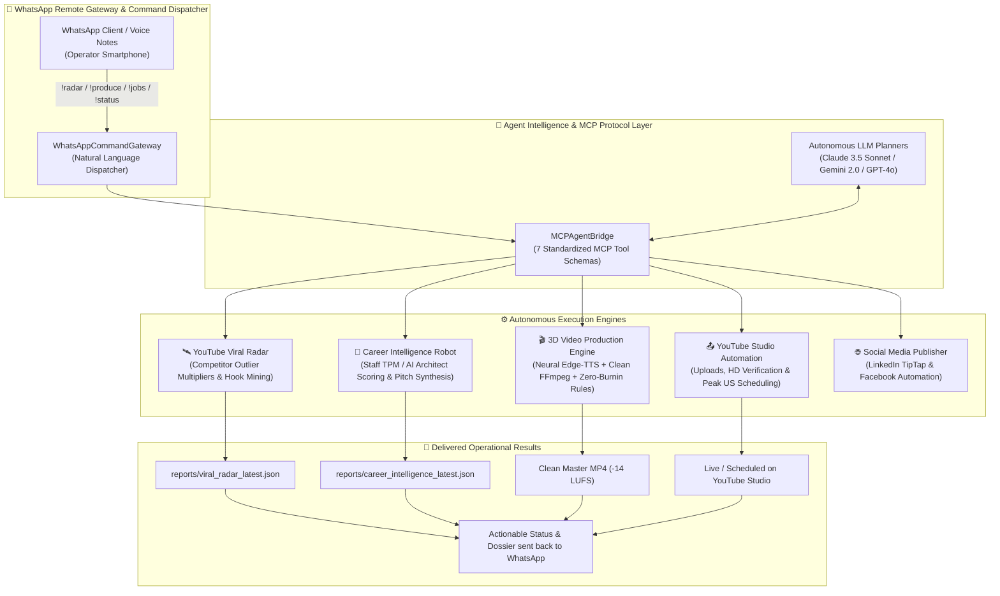

# 🤖 Aegis AgentOS (v2.0) — Autonomous Browser & Multi-Agent Operations System

<div align="center">


<p align="center">
  <b>Enterprise Omni-Agentic Autonomous Operations System</b><br/>
  <i>Engineered by <b>Shabbir Ahmed</b> (AI Systems Architect & Staff Technical Program Manager).<br/>
  Combines Playwright MCP Browser Robots, YouTube Viral Trend Intelligence, Clean 3D Video Production, Career Market Matching, and a 24/7 WhatsApp Remote Command Gateway.</i>
</p>

</div>

---

## ⚡ System Architecture



---

## 🛠️ The Four Core Autonomous Engines

### 1. 📱 WhatsApp Remote Command Center (`src/dispatchers/whatsapp_command_gateway.ts`)
Allows the operator to manage the entire autonomous fleet directly from their phone via WhatsApp messages or voice notes:
- `!radar`: Triggers the competitor outlier crawler and delivers the top 3 breakout concepts with retention scores.
- `!produce <topic>`: Runs the full script-to-master render pipeline with zero manual intervention.
- `!jobs` / `!career`: Scans high-value Staff TPM and AI Architect roles, calculates technical alignment, and returns executive pitches.
- `!status` / `!stats`: Returns real-time YouTube Studio status (HD processing, checks, live views) and GCP cloud VM health.

### 2. 🛰️ YouTube Viral Radar (`src/intelligence/youtube_viral_radar.ts`)
- Automatically monitors benchmark science & 3D animation channels (`@zackdfilms`, `@TheActionLab`, `@veritasium`).
- Calculates **Outlier Multiplier** ($\text{Views}_{\text{video}} / \text{Views}_{\text{channel\_avg}}$) and velocity curves.
- Mines top-performing retention formulas (e.g., *Tutorial Dilemma*, *Catastrophic Scenario Simulation*, *Primal Phobia*).
- Outputs production dossiers to `reports/viral_radar_latest.json`.

### 3. 🎬 Automated 3D Video Production Engine (`src/pipelines/video_production_engine.ts`)
- **Retention Hook Scripting**: Formulates 54-second multi-quest scripts following the Danny Why retention law.
- **Broadcast Voiceover**: Synthesizes Microsoft Edge Neural audio (`en-US-AndrewMultilingualNeural` at +3% speed).
- **Clean Merge Rule**: Strictly enforces zero burn-in writing, zero drawtext filters, and zero HUD borders on the 3D frames, mastering audio to `-14 LUFS` and `-1 dB True Peak`.
- **Autonomous Publishing**: Directly hands off master renders to `YouTubeStudioManager` for automated uploading, HD verification, and peak US prime-time scheduling.

### 4. 💼 Career & Client Opportunity Intelligence Robot (`src/intelligence/career_intelligence_robot.ts`)
- Continuously scans enterprise tech job boards and LinkedIn for Staff/Principal Technical Program Manager and AI Systems Architect roles.
- Evaluates role fit against 4 core competency pillars:
  1. *Autonomous Agent Frameworks (Playwright + MCP)*
  2. *High-Concurrency Microservices (FastAPI / Node.js)*
  3. *Cloud Daemon Infrastructure (GCP Compute Engine, Docker, PM2)*
  4. *Technical Program Delivery & Enterprise SLAs*
- Generates 0–100% Match Scores and tailored 3-paragraph executive pitches saved to `reports/career_intelligence_latest.json`.

---

## 💻 CLI & Autonomous Agent Usage

### Install Dependencies & Build
```bash
npm install
npm run build
```

### Run the Interactive Multi-Agent Suite
```bash
# Execute the complete autonomous sequence (Radar -> Career -> Video Engine -> Gateway)
npm run agent:all

# Run individual autonomous robots
npm run agent:radar
npm run agent:career
npm run agent:produce "The 30-Millisecond Hydrostatic Shockwave"
npm run agent:gateway "!status"
```

### Use via Model Context Protocol (MCP)
Run as an MCP tool provider for Claude Desktop, Gemini CLI, or Antigravity:
```typescript
import { MCPAgentBridge } from 'autonomous-browser-agent-hub';

const bridge = new MCPAgentBridge();

// Execute any registered MCP tool
const result = await bridge.executeTool('scan_youtube_viral_radar', {
  channels: ['@zackdfilms', '@TheActionLab']
});
```

---

## 👤 Author & Architecture
**Shabbir Ahmed (Bishal)**  
*AI Systems Architect • Autonomous Agent Specialist • Technical Program Manager*  
- **GitHub**: [@shabbir2024a](https://github.com/shabbir2024a)  
- **LinkedIn**: [shabbir-ahmed-a095a3334](https://www.linkedin.com/in/shabbir-ahmed-a095a3334/)  
- **YouTube Production Channel**: [@WhatHappensNext-3D](https://youtube.com/@WhatHappensNext-3D)  
- **Email**: shabbir2024a@gmail.com  

---

## 📄 License
MIT License. Open for enterprise agentic automation, research, and production deployment.
